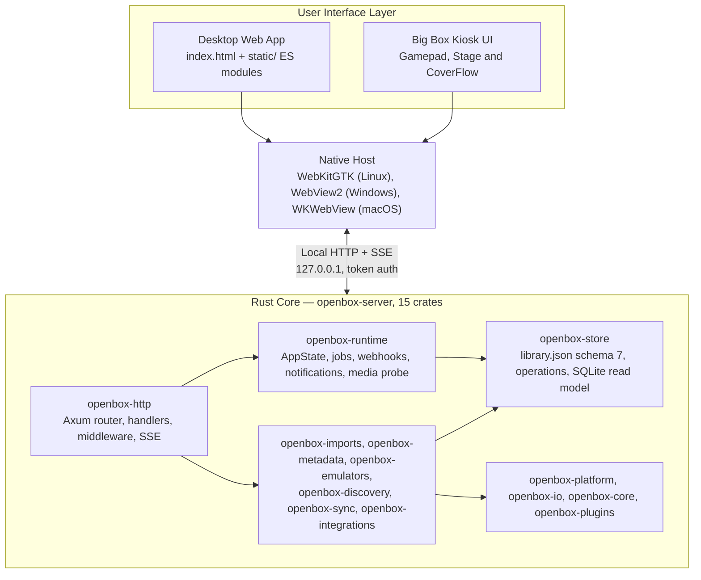

OpenBox is engineered as a **local-first, single-binary** application. The shipped backend is the native Rust server `openbox-server`; the native window hosts are thin platform shells that render the same HTML/CSS/JS UI over loopback. There is no OpenBox account, vendor cloud dependency, or background telemetry service.

## Core architectural layers

## 1. Rust server, zero bundled CPython

`openbox-server` is built from the Cargo workspace in `crates/` (15 crates, 170 migrated backend modules, 417 HTTP endpoints: 413 public `/api/v2/*` plus 4 `/api/host/*`). It uses Tokio, Axum/Hyper, `rusqlite` for the derived read model, and `ed25519-dalek` for release verification. The AppImage, Flatpak, Windows zips, and the macOS `.app` ship this binary directly; no Python interpreter is bundled.

- Binds to `127.0.0.1` only, on an ephemeral port or `OPENBOX_PORT`.
- Publishes `server.port`, `server.token`, and `native-host-flags` in the data directory with owner-only permissions.
- Every non-public request requires `X-OpenBox-Token`; the token is compared in constant time and auth failures are rate-limited.
- The AppImage keeps a `GLIBC_2.35` floor (Ubuntu 22.04).

The Python tree (`web_app.py`, `handlers/`, `pkg/`) still exists for source checkouts. It runs only when `OPENBOX_BACKEND=python` is set or no Rust binary is found, and it requires Python 3.11 or newer.

## 2. Native host and IPC bridge

The native hosts are deliberately thin:

| Platform | Host | Webview | Server supervision |
| --- | --- | --- | --- |
| Linux | `native_host.c` | WebKitGTK 4.1 / GTK 3 | `fork` + `setpgid`, `execl(openbox-server --no-browser)`, inotify boot watch, process-group shutdown |
| Windows | `native_host_win.c` | WebView2 / Win32 | `CreateProcessW` in a job object, graceful `/api/host/shutdown`, `TerminateJobObject` backstop |
| macOS | `native_host_mac.m` | WKWebView / AppKit | `posix_spawn` with process group, `DISPATCH_PROC_EXIT` monitor, 0600 `AF_UNIX` socket |

All three hosts resolve `openbox-server` in the order `OPENBOX_SERVER_BIN` → bundle/share → `target/release` → `PATH`, and fall back to `python3 web_app.py` only when `OPENBOX_BACKEND=python` is set. They inject `window.openboxNative` for native dialogs, reveal/open-external actions, and window controls, and they use `/api/host/*` for launch, resume, shutdown, and capabilities.

## 3. Atomic state store and recovery

`library.json` is the canonical schema 7 state. The store in `crates/openbox-store/src/json_store.rs` provides:

- **Atomic writes:** a temporary file is flushed, fsynced, and atomically renamed; the previous primary is kept as `library.json.bak`.
- **Snapshots:** rotating `library.json.snapshots/<stamp>-<sequence>-<token>.json` files, newest-first, capped at 5. Snapshotting uses hardlinks where possible.
- **Locking:** an in-process ordered mutex plus a cross-process sidecar lock. Windows uses a byte-range lock; POSIX uses `flock`.
- **Crash recovery:** a corrupt primary falls back to `.bak`; `POST /api/v2/state/recover` reports what would be recovered and can snapshot first.
- **Schema policy:** schema 7 opens directly. Schema 6 raises `STATE_SCHEMA_TOO_OLD` and is not rewritten on open; `openbox --migrate-library` is the only writer. Schema 1-5 must be opened once on OpenBox 2.1. A schema above 7 raises `STATE_FUTURE_VERSION`.

Active sessions are mirrored to `sessions.json` (format 1) and removed when none remain. The SQLite read model is a projection; deleting it loses nothing.

## 4. Background operations

Heavy work runs as a durable operation in `crates/openbox-store/src/operations.rs` and `crates/openbox-runtime/src/job_manager.rs`:

- Four concurrent worker slots behind a Tokio semaphore; up to 100 operations retained.
- `operations.json` plus `operations_items/<job_id>.json` survive a restart. A job left `running`, `queued`, or `cancelling` becomes `interrupted` on the next start and can be retried or resumed.
- The browser polls `/api/v2/jobs` (cursor list) and `/api/v2/jobs/items`, and receives `job.*` progress over `/api/v2/events`.
- The media automation queue is a separate durable worker in `media-queue.json`, capped at 5,000 items.

**3.0 scheduling note:** the Rust server's hourly maintenance tick currently unlocks due time capsules and refreshes tray recents. It does not call the automatic backup, Save Vault schedule, Deal Radar poll, or health-rescan helpers; use the manual routes (`/api/v2/backup/create`, `/api/v2/saves/vault/snapshot`, `/api/v2/deals/refresh`, `/api/v2/library/health/scan`) until those schedulers are wired.

## 5. Extension boundaries

OpenBox has three extension styles with different trust and failure models:

- **Plugins** — local packages with `"api_version": 2`. A `.py` entry runs through `plugin_runner_v2.py` with host Python 3.11+; a native executable entry runs directly. Each hook invocation is a separate process, sandboxed with bubblewrap on Linux when available. The Rust server invokes `command`, `events`, and the six capability hooks; `library`, `before_launch`, `after_session`, and `library_source` remain Python-fallback-only.
- **Themes** — local CSS files that override `:root` tokens. They cannot add server operations or execute code.
- **Webhooks** — HMAC-SHA256-signed event delivery over a bounded 128-item queue, with HTTPS by default, an HTTP opt-in, destination validation, and bounded retries.

## 6. Security model and non-goals

The local threat model assumes the desktop account is trusted to run the application and install its extensions. The implemented boundaries prevent accidental exposure, path traversal, unsafe extraction, SSRF, and one failed worker taking down the process. They do not create multi-user authentication, remote tenancy, or a security sandbox for local plugins. Sharing the token grants control of the local instance; installing a plugin grants that package the account's normal filesystem and process privileges.

## Related pages

- [How OpenBoxGL works](/reference/how-it-works/) for the request, import, launch, and session paths.
- [Frontend modules](/reference/architecture/frontend-modules/) for the static JS inventory.
- [Background jobs](/reference/background-jobs/) for operation states and endpoints.
- [Data and recovery](/reference/data-and-recovery/) for the state format and migration rules.
